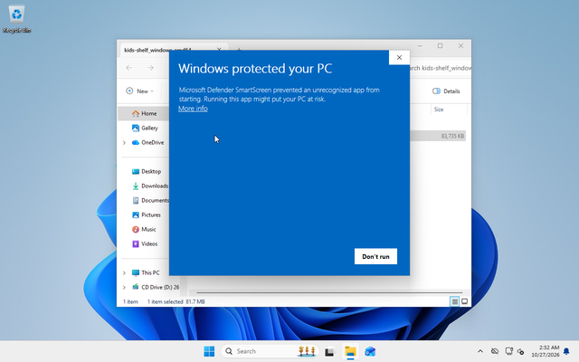
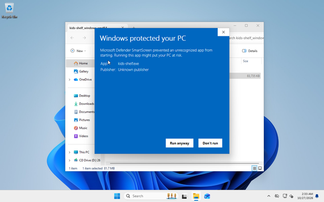
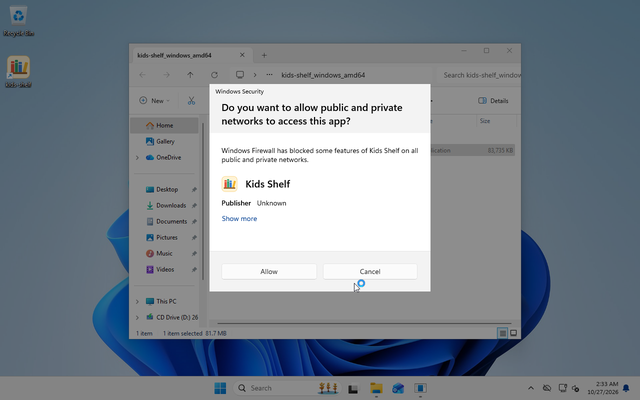
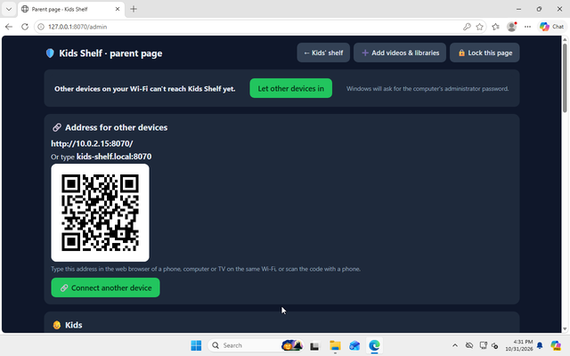
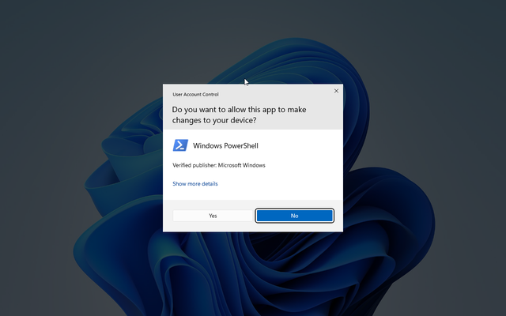
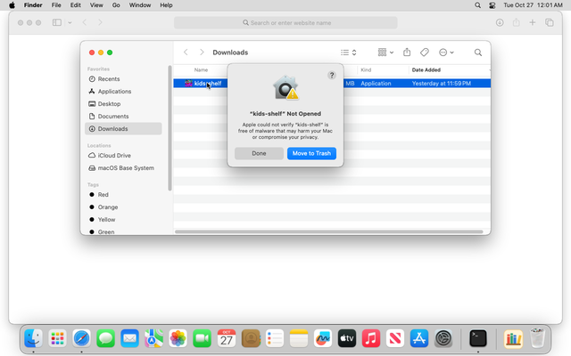
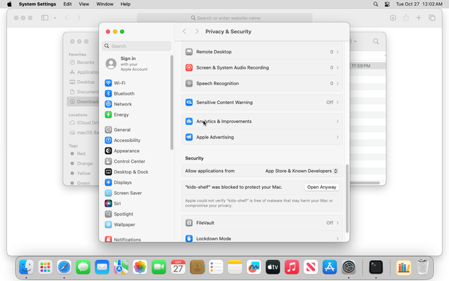
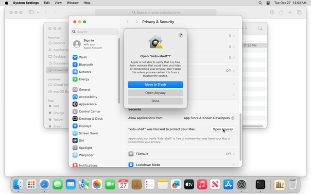
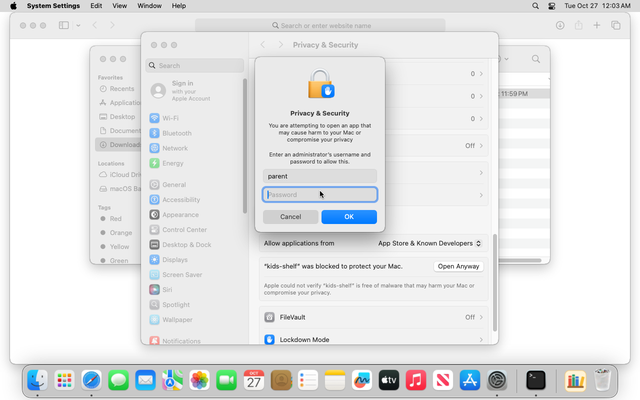

# kids-shelf: a guide for parents

kids-shelf turns one of your computers into a small, private internet for your kids: the
videos you chose, offline libraries such as Wikipedia, and practice games. Nothing goes to
the outside internet while they use it.

## How it fits together

- **One computer runs kids-shelf.** A Windows PC, a Mac or a Linux PC. It keeps the videos and
  libraries, so it needs the disk space (see "How much space" below). It must be switched on
  and awake while the kids watch.
- **Any device with a web browser on your home Wi-Fi is a screen.** A TV with a browser, another
  computer, a phone or a tablet can open kids-shelf. You do not need to buy anything.
- **There are two sides.** The kids' side is what the browser shows first: "Who's watching?".
  The **parent page** is where you add kids, minutes and videos. To get there, click
  **Grown-ups** in the top corner of the kids' side (the very first time, the big
  **Set up kids-shelf** card takes you there).
- A Raspberry Pi 400 works well as a screen. To use a Raspberry Pi as the computer that runs
  kids-shelf, install the 64-bit Raspberry Pi OS and download the Linux ARM version.

## Download

Download from the releases page:
https://github.com/edementhon/kids-shelf/releases/latest

| Your computer | File |
| --- | --- |
| Windows | `kids-shelf_windows_amd64.zip` |
| Mac with an Apple chip (M1 or later) | `kids-shelf_darwin_arm64.zip` |
| Mac with an Intel chip | `kids-shelf_darwin_amd64.zip` |
| Linux PC | `kids-shelf_linux_amd64.zip` |
| Raspberry Pi with 64-bit Raspberry Pi OS | `kids-shelf_linux_arm64.zip` |

kids-shelf is free and is not sold through Microsoft or Apple, so both of them warn you
before it first runs. The warnings sound scary. They are normal for this app, and the steps
below show every one we saw on Windows 11 and macOS 15.

## Windows 11

1. In your Downloads folder, right-click the zip file and choose **Extract All**, then
   **Extract**. Open the new folder and double-click **kids-shelf**.
2. Windows may show **"Windows protected your PC"**. If it does, click **More info**, then
   **Run anyway**. It names the publisher as **Unknown publisher**: that is expected for
   kids-shelf. (On some computers this screen does not appear at all.)

   
   

   Windows asks this at most once for each file you download. The updates kids-shelf installs
   by itself do not ask.
3. Windows Firewall asks **"Do you want to allow public and private networks to access this
   app?"** for **Kids Shelf** (Publisher: Unknown, again expected). Click **Allow**: it lets the
   other devices on your home Wi-Fi reach kids-shelf.

   

4. kids-shelf installs itself and opens in your browser. From now on, start it from the
   **kids-shelf** icon on the desktop or in the Start menu. You can delete the zip and the
   folder in Downloads.

**If you clicked Cancel at the firewall question, or the other devices stop connecting later,**
the parent page says **"Other devices on your Wi-Fi can't reach kids-shelf yet"**. (On our test machine,
Allow only covered the kind of network the computer was on at the time: after we switched the
network from Public to Private in Windows settings, Windows blocked kids-shelf again.) Click
**Let other devices in**. Windows asks **"Do you want to allow this app to make changes to your
device?"** for **Windows PowerShell** (publisher: Microsoft Windows): that is the part that adds
the firewall rule, so click **Yes**.

**Smart App Control.** Some Windows 11 computers have Smart App Control switched on (most
computers that were upgraded from Windows 10 do not). Windows then checks new programs it has
not seen before, and kids-shelf is new to it:

- The first time, nothing may appear for a minute or two after you double-click kids-shelf
  while Windows checks it (about 90 seconds on our test computer). Wait two minutes before you
  double-click it again.
- Usually kids-shelf opens, but Windows holds back its video tools for a while. The parent page
  then says **"Windows is checking kids-shelf's video tools"**, and videos appear once Windows is
  done. On our test computer that took about 20 minutes and two restarts. Nothing is lost: the
  videos you already added carry on by themselves.
- Sometimes it stops kids-shelf itself with **"Smart App Control blocked an app that may be
  unsafe"**, with no button to run it anyway. Windows is still checking kids-shelf. Wait about
  an hour, then open kids-shelf again. (On our test computer the block lifted after 46
  minutes; restarting sooner did not help.)

If it stays blocked after that, the only way past it is to turn Smart App Control off (Windows
Security, App & browser control, Smart App Control settings). Some versions of Windows do not
let you turn it back on without resetting Windows, so decide whether that trade is worth it for
your family.

## Mac (macOS 15)

**Apple shows three warnings that use the words "malware" and "harm your Mac". They are normal
for this app, because it is not sold through Apple. Never click Move to Trash.**

1. Download the zip in Safari. Safari asks **"Do you want to allow downloads on github.com?"**:
   click **Allow**. Safari unzips it, and **kids-shelf** appears in your Downloads folder.
2. Double-click **kids-shelf**. macOS says **"kids-shelf" Not Opened**. Click **Done** (not Move
   to Trash).

   

3. Open the Apple menu, **System Settings**, **Privacy & Security**. Scroll down to Security:
   it says **"kids-shelf" was blocked to protect your Mac**. Click **Open Anyway**.

   

4. macOS asks once more. Click **Open Anyway**, then type your Mac password. (On a Mac account
   without administrator rights, someone who has them types theirs.)

   
   

5. kids-shelf installs itself into your **Applications** folder, puts its icon (a little
   bookshelf) in the **Dock** at the bottom of the screen, and opens in Safari. From now on,
   click that icon in the Dock. You can delete the copy in Downloads.
6. macOS asks **"Allow "kids-shelf" to find devices on local networks?"**. Click **Allow**: it
   lets other devices find kids-shelf by its name, kids-shelf.local. If you click Don't Allow,
   they can still use the computer's address (see "Connect other devices").

The Mac firewall is off unless you turned it on. If it is on, macOS may ask whether kids-shelf
may accept incoming connections; choose Allow. (We have not seen this question ourselves.)

## Linux

Unzip the file, open a terminal in that folder and run `./kids-shelf` (some file managers also
start it on a double-click). It installs itself into `~/.local/share/kids-shelf/app`, adds
itself to your applications menu and opens in your browser.

If other devices cannot connect, your firewall may be blocking kids-shelf's two ports, 8070 and
8071. On Ubuntu (ufw): `sudo ufw allow 8070/tcp` and `sudo ufw allow 8071/tcp`. On Fedora
(firewalld): `sudo firewall-cmd --permanent --add-port=8070/tcp --add-port=8071/tcp`, then
`sudo firewall-cmd --reload`. For the name kids-shelf.local, also allow `5353/udp` the same way.

## First things on the parent page

1. **Make a parent PIN.** The first time you open the parent page it asks for one: 4 digits
   only you know. The kids can see the **Grown-ups** link, so the page always needs it. You can
   change it later under Settings. **Forgot it?** Open the parent page on the computer kids-shelf
   runs on (from its icon there), click **Forgot the PIN?**, then **Reset the parent PIN**. Other
   devices cannot reset it. Once the PIN is saved, the page walks you through opening kids-shelf
   on another device (see "Connect other devices" below).
2. **Add your kids**, each with their own PIN, and set their daily minutes.
3. **Set a grown-up PIN** under Settings. "Watch together" (free watching with a grown-up)
   asks for it; until you set one, it tells the kids to ask you. Watching together ends after two
   hours, or when you press **End watching together**.

## Connect other devices

Right after you make the parent PIN, the parent page opens **Open kids-shelf on another
device**. Do this for each screen the kids will use:

1. Put the device on the same Wi-Fi as the computer.
2. **On a phone or tablet:** point its camera at the QR code on the screen, then tap the link
   that appears. The shelf opens, and the parent page says **"A device just connected."** If
   the name kids-shelf.local works on that device, the shelf moves to it by itself a moment
   later, so the icon you save next keeps working even if the computer's number address
   changes.

   **On a TV, another computer or anything without a camera:** open its web browser and type
   the address the page shows: `kids-shelf.local:8070`. If that does not open, type the number
   address the page shows instead, like `192.168.1.20:8070`. (Some computers cannot announce
   the name; then the page shows only the number address.)
3. Save it so the kids can find it. On a computer or TV: add a bookmark. On an iPhone or iPad
   (Safari): **Share**, then **Add to Home Screen**. On Android (Chrome): the **⋮** menu, then
   **Add to Home screen**.

To add another device later, click **Connect another device** in **Address for other devices**,
near the top of the parent page. That card also shows the address and the QR code. If a saved
bookmark or icon stops opening the shelf (for example, the router gave the computer a new
number address after a restart), connect that device again the same way.

## Add videos and libraries

On the parent page, click **Add videos & libraries**:

- **Add from YouTube**: paste a link to a video, a playlist or a channel and click **Add**.
  kids-shelf downloads every video and keeps a copy, so the kids never see YouTube itself.
- **Add a folder or NAS share**: type the path to a folder of videos and click **Add folder**.
  Each folder inside it becomes a show (for example `Kids/Bluey/` and `Kids/Octonauts/`), and
  videos lying loose in it form a show named after the folder. kids-shelf tells you how many
  videos it found, and every one appears on the shelf within minutes. **Scan now** picks up
  videos you add later. If a video could not be added, its row has **Try again**; if a folder's
  drive or NAS is unplugged, its row says so.
- **Offline libraries**: search for a library (Wikipedia, Vikidia, PhET science simulations and
  others) and click **Download**.

### Library files you already have

If you already have library files (`.zim`, for example from the Kiwix app), kids-shelf can use
them where they are, without copying them. Under **Offline libraries**, in **Library files on this
computer**, type the path to the folder that holds them and click **Use this folder**. Every
`.zim` file in that folder and in the folders inside it goes on the shelf. kids-shelf looks in
the folder again every 10 minutes, so files you add later appear by themselves; **Look again**
does it at once. If the folder is on a drive or NAS that is not connected, its libraries show as
missing until it is back. **Stop using this folder** takes its libraries off the shelf. kids-shelf
never changes, moves or deletes the files themselves.

## How much space

Videos that browsers play well as they are (most MP4 files) play from where they are, with no
copy. A video browsers cannot play well (for example one with Dolby or DTS sound, which would
play silent, or HEVC video, which may play black) appears on the shelf marked **Getting ready**
while kids-shelf makes a better copy in the background; the quick fixes come first and the long
ones last, and the episode starts playing once its copy is done. The **Fixing videos** card on
the **Add videos & libraries** page shows how many are waiting. kids-shelf never changes or
deletes your own files. Videos downloaded from YouTube live in kids-shelf's own folder.

Making those copies is hard work for the computer. kids-shelf uses the computer's graphics chip
when it can, which is much faster; Settings on the parent page shows which it uses under
**Use the graphics chip to convert videos**.

MKV files need a copy only for iPads, iPhones and Macs using Safari, which cannot open them. If
none of your screens use Safari, untick **Some screens are iPads, iPhones or Macs using Safari**
under Settings on the parent page, and kids-shelf skips those copies.

For the offline libraries, some examples:

| Library | Size |
| --- | --- |
| Vikidia (an encyclopedia written for 8 to 13 year olds) | 74 MB |
| PhET science simulations | 104 MB |
| Wikipedia, top 100 articles | 318 MB |
| All of English Wikipedia | about 120 GB |

## Updates

kids-shelf checks for a new version once a day and downloads it by itself. The parent page then
shows **Restart to update**. After the restart it checks for 30 seconds that the new version
works, and goes back to the old one if it does not.

## Removing kids-shelf

On the parent page, use **Remove kids-shelf from this computer**. Your videos and settings stay
unless you tick **also delete videos and settings**; the confirmation names both folders. Your
own video folders are never deleted, either way.

On Windows you can also remove it from **Settings, Apps, Installed apps, kids-shelf, Uninstall**.
Quit kids-shelf first (parent page, **Quit kids-shelf**); if it is still running, Windows says so
and opens the parent page.

Either way, Windows asks once more for permission (**Windows PowerShell**, publisher Microsoft
Windows) so kids-shelf can take its firewall rule away too; if you say No, kids-shelf is still
removed and the rule simply stays.

On a Mac, removing kids-shelf also takes its icon out of the Dock.

If you removed kids-shelf but kept its videos and settings, install the newest version again: a
copy older than the one this computer already ran refuses to start and says so, because it
cannot read what the newer version saved.
