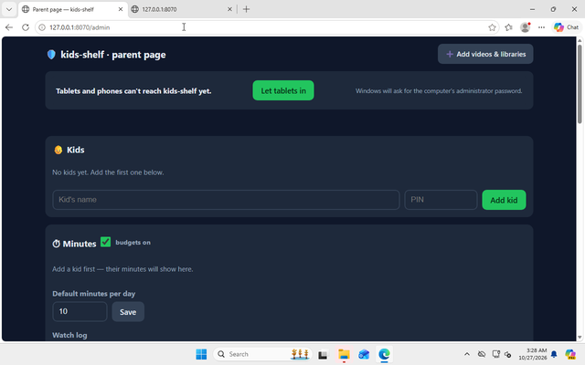

# kids-shelf: a guide for parents

kids-shelf turns one of your computers into a small, private internet for your kids: the
videos you chose, offline libraries such as Wikipedia, and practice games. Nothing goes to
the outside internet while they use it.

## How it fits together

- **One computer runs kids-shelf.** A Windows PC, a Mac or a Linux PC. It keeps the videos and
  libraries, so it needs the disk space (see "How much space" below). It must be switched on
  and awake while the kids watch.
- **Tablets, phones and other computers are the screens.** Any device with a web browser on
  your home Wi-Fi can open kids-shelf.
- **There are two sides.** The kids' side is what the browser shows first: "Who's watching?".
  The **parent page** is where you add kids, minutes and videos. To get there, click
  **Grown-ups** in the top corner of the kids' side (the very first time, the big
  **Set up kids-shelf** card takes you there).
- A Raspberry Pi 400 works well as a screen. To use a Raspberry Pi as the computer that runs
  kids-shelf, install the 64-bit Raspberry Pi OS and download the Linux ARM version.

## Download

Download from the releases page:
https://github.com/edementhon/kids-shelf/releases/latest

| Your computer | File |
| --- | --- |
| Windows | `kids-shelf_windows_amd64.zip` |
| Mac with an Apple chip (M1 or later) | `kids-shelf_darwin_arm64.zip` |
| Mac with an Intel chip | `kids-shelf_darwin_amd64.zip` |
| Linux PC | `kids-shelf_linux_amd64.zip` |
| Raspberry Pi with 64-bit Raspberry Pi OS | `kids-shelf_linux_arm64.zip` |

kids-shelf is free and is not sold through Microsoft or Apple, so both of them warn you
before it first runs. The warnings sound scary. They are normal for this app, and the steps
below show every one we saw on Windows 11 and macOS 15.

## Windows 11

1. In your Downloads folder, right-click the zip file and choose **Extract All**, then
   **Extract**. Open the new folder and double-click **kids-shelf**.
2. Windows shows **"Windows protected your PC"**. Click **More info**, then **Run anyway**.
   It names the publisher as **Unknown publisher**: that is expected for kids-shelf.

   
   

   Windows asks this once for each file you download. The updates kids-shelf installs by
   itself do not ask.
3. Windows Firewall asks **"Do you want to allow public and private networks to access this
   app?"** for **Kids Shelf** (Publisher: Unknown, again expected). Click **Allow**: it lets the
   tablets and phones on your home Wi-Fi reach kids-shelf.

   

4. kids-shelf installs itself and opens in your browser. From now on, start it from the
   **kids-shelf** icon on the desktop or in the Start menu. You can delete the zip and the
   folder in Downloads.

**If you clicked Cancel at the firewall question, or the tablets stop connecting later,** the
parent page says **"Tablets and phones can't reach kids-shelf yet"**. (On our test machine,
Allow only covered the kind of network the computer was on at the time: after we switched the
network from Public to Private in Windows settings, Windows blocked kids-shelf again.) Click
**Let tablets in**. Windows asks **"Do you want to allow this app to make changes to your
device?"** for **Windows PowerShell** (publisher: Microsoft Windows): that is the part that adds
the firewall rule, so click **Yes**.

**Smart App Control.** Some Windows 11 computers have Smart App Control switched on (most
computers that were upgraded from Windows 10 do not). It can stop kids-shelf with the message
**"Smart App Control blocked an app that may be unsafe"**, and it offers no button to run it
anyway. On our test machine it blocked kids-shelf once and then, after a restart, let the same
file run, so we cannot tell you in advance what it will do. If you see that message, restart the
computer and open kids-shelf once more. If it is still blocked, the only way past it is to turn
Smart App Control off (Windows Security, App & browser control, Smart App Control settings).
Windows may not let you turn it back on without resetting Windows, so decide whether that
trade is worth it for your family.

## Mac (macOS 15)

**Apple shows three warnings that use the words "malware" and "harm your Mac". They are normal
for this app, because it is not sold through Apple. Never click Move to Trash.**

1. Download the zip in Safari. Safari asks **"Do you want to allow downloads on github.com?"**:
   click **Allow**. Safari unzips it, and **kids-shelf** appears in your Downloads folder.
2. Double-click **kids-shelf**. macOS says **"kids-shelf" Not Opened**. Click **Done** (not Move
   to Trash).

   

3. Open the Apple menu, **System Settings**, **Privacy & Security**. Scroll down to Security:
   it says **"kids-shelf" was blocked to protect your Mac**. Click **Open Anyway**.

   

4. macOS asks once more. Click **Open Anyway**, then type your Mac password. (On a Mac account
   without administrator rights, someone who has them types theirs.)

   
   

5. kids-shelf installs itself into your **Applications** folder, puts its icon (a little
   bookshelf) in the **Dock** at the bottom of the screen, and opens in Safari. From now on,
   click that icon in the Dock. You can delete the copy in Downloads.

The Mac firewall is off unless you turned it on. If it is on, macOS may ask whether kids-shelf
may accept incoming connections; choose Allow. (We have not seen this question ourselves.)

## Linux

Unzip the file, open a terminal in that folder and run `./kids-shelf` (some file managers also
start it on a double-click). It installs itself into `~/.local/share/kids-shelf/app`, adds
itself to your applications menu and opens in your browser.

If the tablets cannot connect, your firewall may be blocking kids-shelf's two ports, 8070 and
8071. On Ubuntu (ufw): `sudo ufw allow 8070/tcp` and `sudo ufw allow 8071/tcp`. On Fedora
(firewalld): `sudo firewall-cmd --permanent --add-port=8070/tcp --add-port=8071/tcp`, then
`sudo firewall-cmd --reload`.

## First things on the parent page

1. **Lock the parent page.** Once you have added a kid, the parent page asks you to set a
   parent-page PIN. Do it: without one, anyone who opens the parent page on a tablet can change
   the minutes or remove kids-shelf.
2. **Add your kids**, each with their own PIN, and set their daily minutes.
3. **Set a grown-up PIN** under Settings. "Watch together" (free watching with a grown-up)
   asks for it; until you set one, it tells the kids to ask you.

## Connect the tablets

Near the top of the parent page is **Address for other devices**, with an address like
`http://192.168.1.20:8070/` and a QR code. On each tablet, open that address in the browser,
or point the camera at the QR code, and add it to the home screen. The tablets must be on the
same Wi-Fi as the computer.

## Add videos and libraries

On the parent page, click **Add videos & libraries**:

- **Add from YouTube**: paste a link to a video, a playlist or a channel and click **Add**.
  kids-shelf downloads every video and keeps a copy, so the kids never see YouTube itself.
- **Add a folder or NAS share**: type the path to a folder of videos and click **Add folder**.
  kids-shelf looks through it right away; **Scan now** picks up videos you add later.
- **Offline libraries**: search for a library (Wikipedia, Vikidia, PhET science simulations and
  others) and click **Download**.

## How much space

Videos from a folder that browsers can already play (most MP4 files) play from where they are,
with no second copy. kids-shelf makes its own copy only of videos browsers cannot play as they
are (for example MKV files, or videos with Dolby or DTS sound), and it never changes or deletes
your own files. Videos downloaded from YouTube live in kids-shelf's own folder.

For the offline libraries, some examples:

| Library | Size |
| --- | --- |
| Vikidia (an encyclopedia written for 8 to 13 year olds) | 74 MB |
| PhET science simulations | 104 MB |
| Wikipedia, top 100 articles | 318 MB |
| All of English Wikipedia | about 120 GB |

## Updates

kids-shelf checks for a new version once a day and downloads it by itself. The parent page then
shows **Restart to update**. After the restart it checks for 30 seconds that the new version
works, and goes back to the old one if it does not.

## Removing kids-shelf

On the parent page, use **Remove kids-shelf from this computer**. Your videos and settings stay
unless you tick **also delete videos and settings**; the confirmation names both folders. Your
own video folders are never deleted, either way.

On Windows you can also remove it from **Settings, Apps, Installed apps, kids-shelf, Uninstall**.
Quit kids-shelf first (parent page, **Quit kids-shelf**); if it is still running, Windows says so
and opens the parent page. During removal Windows asks once more for permission
(**Windows PowerShell**, publisher Microsoft Windows) so kids-shelf can take its firewall rule
away too; if you say No, kids-shelf is still removed and the rule simply stays.

On a Mac, removing kids-shelf also takes its icon out of the Dock.

If you removed kids-shelf but kept its videos and settings, install the newest version again: a
copy older than the one this computer already ran refuses to start and says so, because it
cannot read what the newer version saved.
